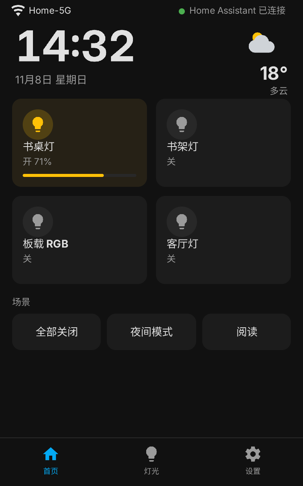
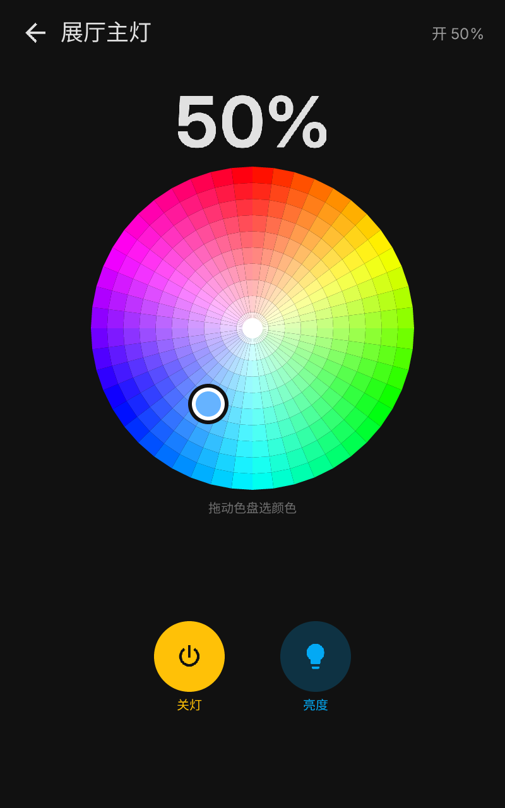
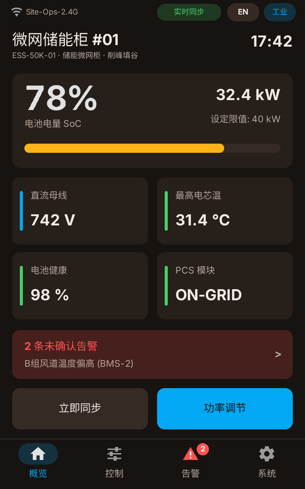
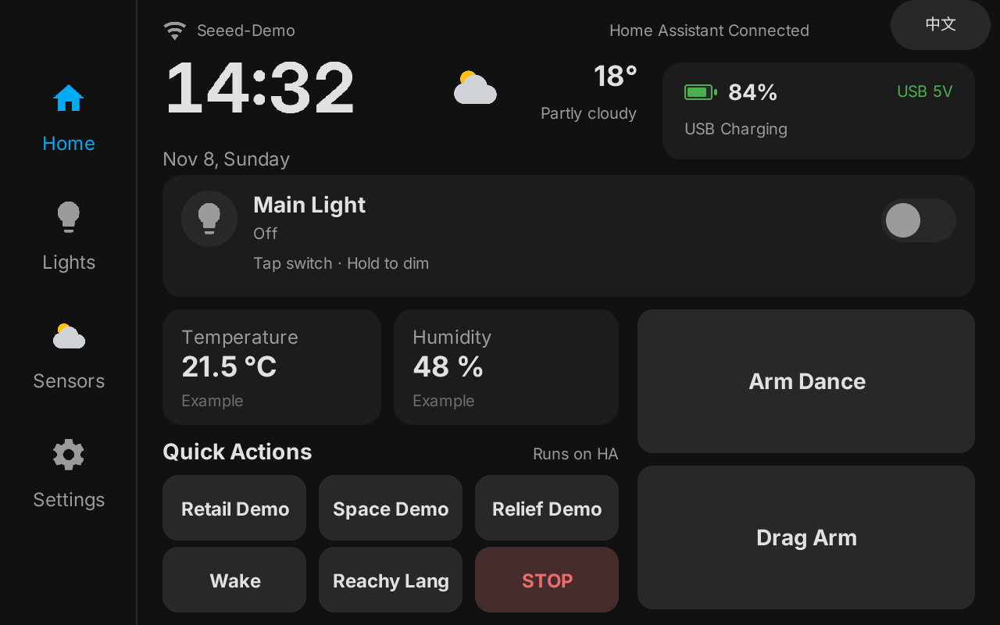
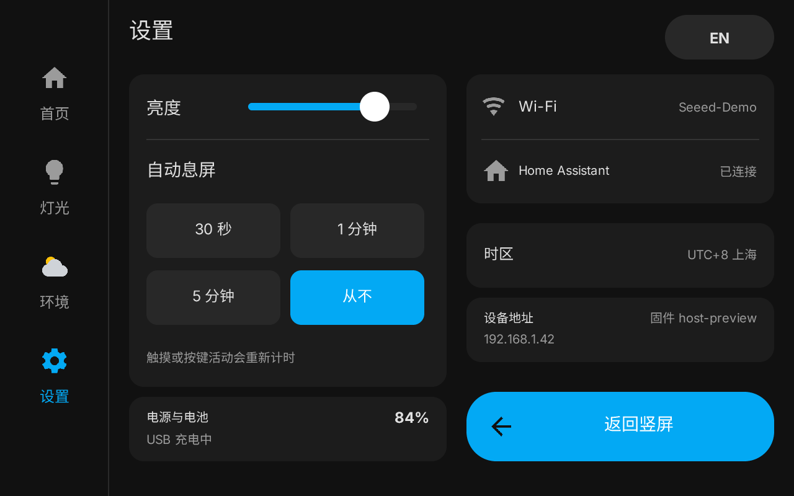
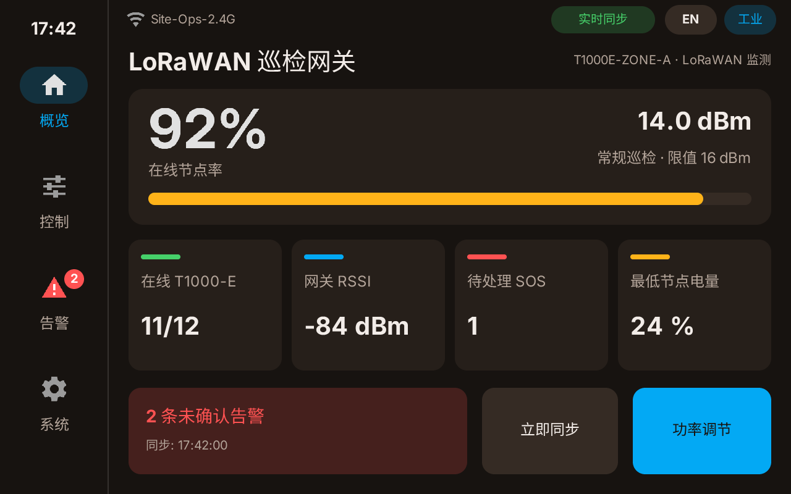

# PocketJS for reTerminal D1001


**English** | [简体中文](README.zh-CN.md)

A TypeScript/SolidJS app runtime and ESP-IDF board platform for the Seeed reTerminal D1001 (ESP32-P4 + 8" 800×1280 JD9365 MIPI-DSI touchscreen). Build responsive, native-feeling touch apps—from custom dashboards and kiosks to interactive tools and ambient displays—without writing LVGL/Qt boilerplate or carrying a Linux/WebView stack.

## Showcase

All screenshots below are **rendered directly by the repository's built-in WASM host**, exercising the exact same `@pocketjs/framework` + `solid-js` UI pipeline that runs on the ESP32-P4 hardware across both `400×640` portrait and `640×400` landscape logical viewports (`800×1280` / `1280×800` physical panel).

### Portrait (`400×640` logical canvas)

| [`apps/ha-panel`](apps/ha-panel) — Smart Home Dashboard | [`apps/showroom-ha-panel`](apps/showroom-ha-panel) — RGB Color Wheel | [`apps/field-ops-panel`](apps/field-ops-panel) — ESS Microgrid Ops |
| :---: | :---: | :---: |
|  |  |  |
| Lighting cards with active dimmer bar, scene presets & bottom tab bar. | Interactive HSV color wheel, brightness toggle & hold-to-dim control. | SoC gauge, DC bus / cell telemetry, unacked alarm banner & quick actions. |

### Landscape (`640×400` logical canvas)

| [`apps/showroom-ha-panel`](apps/showroom-ha-panel) — Bilingual Home (EN) | [`apps/showroom-ha-panel`](apps/showroom-ha-panel) — System Settings | [`apps/field-ops-panel`](apps/field-ops-panel) — LoRaWAN Gateway |
| :---: | :---: | :---: |
|  |  |  |
| Live CN/EN toggle, battery & USB 5V status, sensor cards & quick actions. | Backlight slider, auto-sleep timer, Wi-Fi/HA status & orientation switch. | Online node ratio, T1000-E tracker count, gateway RSSI & active SOS alert. |

## Why PocketJS on D1001

- **TypeScript + SolidJS UI, native ESP32-P4 rendering**: Author screens and state in `@pocketjs/framework` + `solid-js` (`400×640` portrait / `640×400` landscape logical viewports) while native dual-lane PPA and GDMA retained-move scrolling drive the 800×1280 RGB565 panel directly—no LVGL dependency.
- **Instant cold boot, tiny DMA footprint**: Apps execute directly on `quickjs-ng 0.14.0` over ESP-IDF, avoiding OS/browser overhead and bounding internal DMA display staging to two buffers totaling ≤ 128 KiB.
- **Desktop WASM preview & ~3s delta hot-push**: Render portrait/landscape screenshots locally before touching hardware, then push app-only PKAP v1 delta updates over USB or Wi-Fi in ~3 seconds (`bun run app:push`).
- **Firmware-owned hardware & safety boundary**: ESP-IDF owns I2C, PCA9535, backlight, physical `CIRCLE` button arbitration, Wi-Fi preset rotation, and per-slot `data.fs`. Invalid or empty `apps` slots safely fall back to the embedded firmware app (`apps/worker-http`).

## Quick Start

Install [Bun](https://bun.sh/) (`>= 1.4.4`), then clone and preview an app locally without any hardware:

```sh
git submodule update --init third_party/pocketjs
bun install

# Render portrait & landscape PNG previews in the local WASM host
bun run preview --smoke
bun run ops:preview --smoke
```

To push an app onto a D1001 (with [ESP-IDF 6.2](docs/build-and-deploy.md#toolchain-requirements) sourced for `esptool` / `idf.py`):

```sh
. ~/esp/esp-idf-6.2/export.sh

# App-only ~3s hot-push (no firmware rebuild)
bun run app:push apps/ha-panel
bun run app:push apps/ha-panel --wifi <device-ip>   # requires dev hot-push firmware
```

First-time firmware flashing or partition migration: see [Build, Flash, and Hot-Push Guide](docs/build-and-deploy.md).

## Two Ways to Build Apps

This repository is structured for both **AI-assisted iteration** and **hand-crafted TypeScript/ESP-IDF development**:

### Option A: AI-Assisted Workflow (Edit → Preview → Push)

The repository includes [`AGENTS.md`](AGENTS.md) and [`skills/pocketjs-app-dev/SKILL.md`](skills/pocketjs-app-dev/SKILL.md) so coding agents know the hardware boundaries, font pipeline, and verification gates:

1. **Generate or remix a UI**: Point your agent at an existing app under [`apps/`](apps) (or ask for a new screen layout, theme, or data screen) constrained to capabilities registered in [`pocket.host.json`](programs/reterminal-d1001/pocket.host.json).
2. **Verify visually in WASM**: Have the agent run `bun run pocket check`, regenerate baked CJK font subsets if needed, and inspect rendered portrait/landscape PNGs (`bun run preview --smoke` / `bun run ops:preview --smoke`).
3. **Hot-push to device**: Run `bun run app:push apps/<app> --wifi <device-ip>` to update the screen in ~3 seconds, or flash firmware once via `idf.py -C programs/reterminal-d1001 flash monitor`.

### Option B: Classic Developer Workflow

Building an app manually from scratch follows a standard TypeScript workflow:

1. **Create manifest & entry**: Add `apps/<my-app>/pocket.app.json` declaring required host capabilities (`input.touch`, `net.http`, `runtime.worker`, `data.fs`, etc.), and write SolidJS screens in `main.tsx` (plus an optional `worker.ts` for background HTTP polling).
2. **Check host contract & fonts**: If rendering CJK text, run a deterministic font subset script (see [`apps/field-ops-panel/fonts/tool.ts`](apps/field-ops-panel/fonts/tool.ts)), then validate compatibility and flash budget:
   ```sh
   bun run pocket check --manifest apps/<my-app>/pocket.app.json \
     --host-config programs/reterminal-d1001/pocket.host.config.ts
   ```
3. **Preview & test locally**: Add a WASM preview script under [`tools/`](tools) (following [`tools/ha-panel-preview.ts`](tools/ha-panel-preview.ts)) to verify touch interactions and layouts off-device.
4. **Deploy**: Push the compiled PKAP v1 bundle with `bun run app:push apps/<my-app>`.

## Repository Overview

| App / Directory | Purpose | Reference |
|---|---|---|
| [`apps/ha-panel`](apps/ha-panel) | Forkable dual-orientation dashboard template with virtual/onboard/HA adapters & dimmer | [`README`](apps/ha-panel/README.md) |
| [`apps/field-ops-panel`](apps/field-ops-panel) | Multi-profile template with live themes, offline cache lockout & `VirtualList` events | [`README`](apps/field-ops-panel/README.md) |
| [`apps/showroom-ha-panel`](apps/showroom-ha-panel) | Bilingual CN/EN app example with `audio.pcm` tap feedback, color wheel & slot `data.fs` | [`README`](apps/showroom-ha-panel/README.md) |
| [`apps/worker-http`](apps/worker-http) | Minimal embedded factory fallback app (`runtime.worker` HTTP polling) | [`README`](apps/worker-http/README.md) |
| [`apps/input-test`](apps/input-test) | Touch calibration, GPIO3 `CIRCLE` press & 80-row GDMA scroll self-test | — |
| [`apps/system-test`](apps/system-test) | `data.fs` persistence, 7-color RGB LED, backlight & Wi-Fi scan self-test | — |
| [`apps/hello-d1001`](apps/hello-d1001) | Minimal package for benchmarking `~3s` `app:push` loops | — |
| [`platforms/esp-idf`](platforms/esp-idf) | Native ESP-IDF board, audio, FS, HTTP, Wi-Fi, worker & hot-push components | [`d1001_board`](platforms/esp-idf/d1001_board/README.md) |
| [`programs/reterminal-d1001`](programs/reterminal-d1001) | ESP32-P4 host firmware, `partitions.csv`, and [`pocket.host.json`](programs/reterminal-d1001/pocket.host.json) | [Architecture](docs/architecture-and-firmware.md) |
| [`tools`](tools) | `app:push`, partition guards, WASM preview harnesses & mock servers | [Build & Deploy](docs/build-and-deploy.md) |

- **Registered host capabilities** ([`pocket.host.json`](programs/reterminal-d1001/pocket.host.json)): `audio.pcm`, `data.fs`, `input.buttons`, `input.touch`, `net.http`, `runtime.worker`, `system.device`, `system.wifi`, `text.glyphs.baked`.
- **Expanding hardware BSPs (in progress, not yet registered)**: ES7210 dual-mic capture, SC2356 MIPI-CSI camera, LSM6DS3TR 6-axis IMU, and Mini-PCIe 4G LTE.

## Deep-Dive Docs

- [`docs/architecture-and-firmware.md`](docs/architecture-and-firmware.md) — Layering rules, PPA/GDMA rendering, GPIO3 button & wake arbitration, FAT storage, and Wi-Fi preset rotation.
- [`docs/build-and-deploy.md`](docs/build-and-deploy.md) — Full toolchain versions, `sdkconfig.local` precedence, partition migration, serial diagnostics, and USB/Wi-Fi hot-push internals.
- [`AGENTS.md`](AGENTS.md) & [`skills/pocketjs-app-dev/SKILL.md`](skills/pocketjs-app-dev/SKILL.md) — Engineering constraints and AI agent workflow rules.
