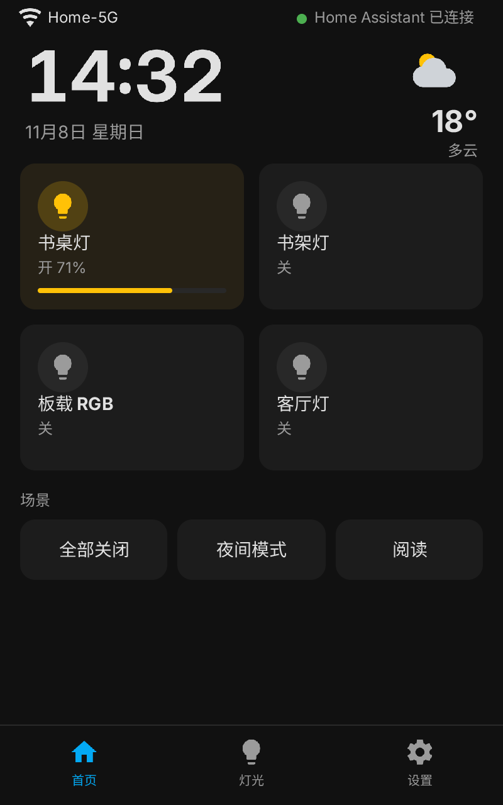
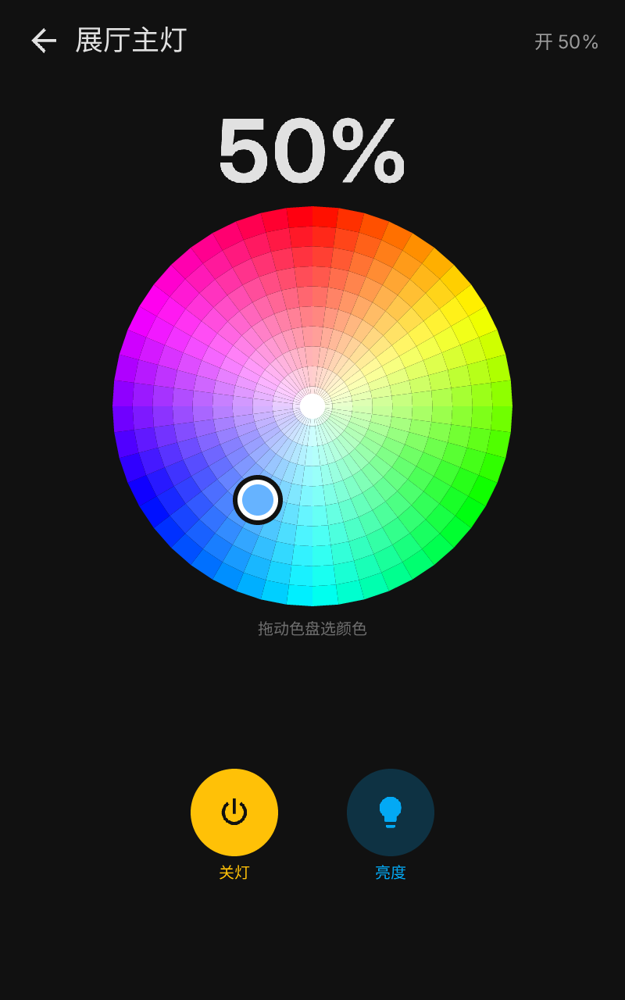
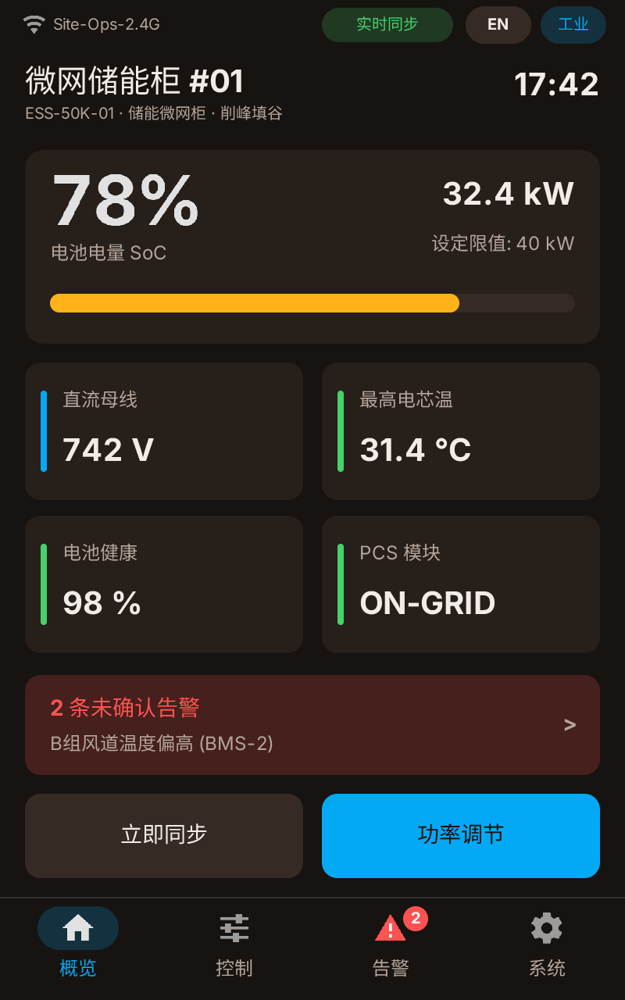
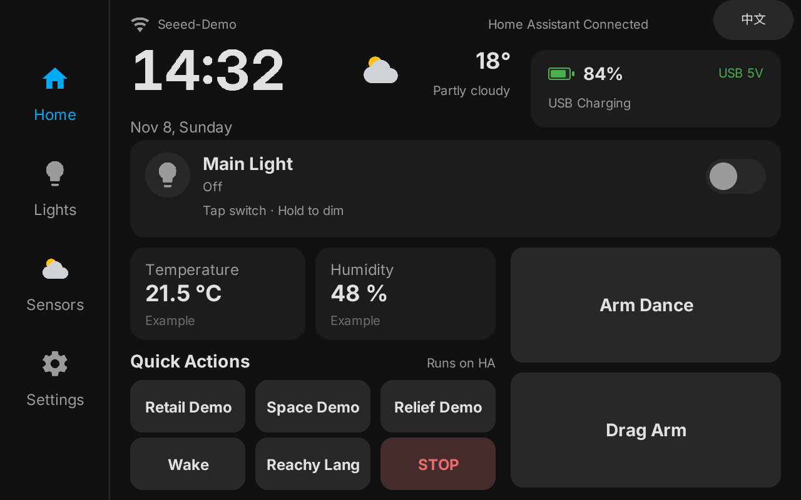
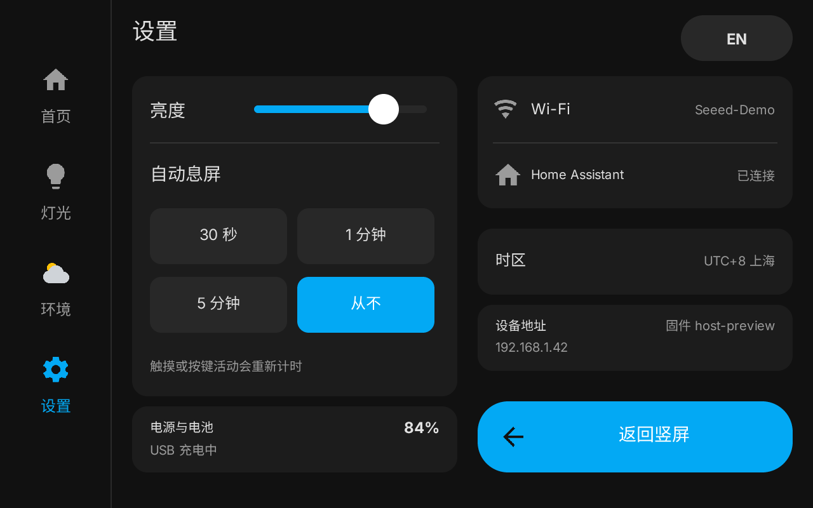
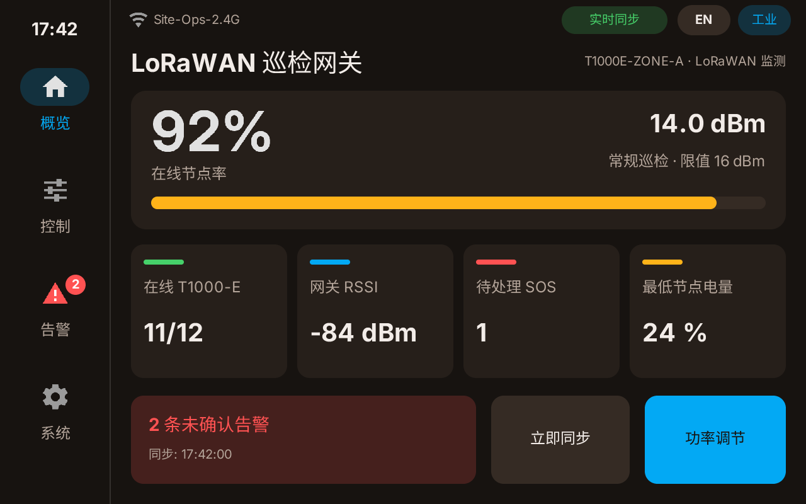

# PocketJS for reTerminal D1001


[English](README.md) | **简体中文**

面向 Seeed reTerminal D1001（ESP32-P4 + 8 英寸 800×1280 JD9365 MIPI-DSI 触摸屏）的 PocketJS 应用运行时与 ESP-IDF 板级平台。用 TypeScript + SolidJS 开发流畅的原生级触屏应用——无论信息看板、交互工具、桌面终端还是设备界面，都无需手写 LVGL/Qt 样板，也没有 Linux/WebView 包袱。

## 界面展示（Showcase）

以下界面截图均由**仓库内置 WASM 宿主直接渲染**，复用与 ESP32-P4 真机一致的 `@pocketjs/framework` + `solid-js` 渲染管线，分别对应竖屏 `400×640` 与横屏 `640×400` 逻辑画布（物理屏幕分辨率 `800×1280` / `1280×800`）。

### 竖屏界面（`400×640` 逻辑画布）

| [`apps/ha-panel`](apps/ha-panel) — 智能家居仪表盘 | [`apps/showroom-ha-panel`](apps/showroom-ha-panel) — RGB 色轮调光 | [`apps/field-ops-panel`](apps/field-ops-panel) — 储能微网看板 |
| :---: | :---: | :---: |
|  |  |  |
| 灯光卡片与亮度进度条、场景快捷触发及底部导航栏。 | 交互式 HSV 色盘、开关与长按调光控制界面。 | SoC 电量条、直流母线/电芯遥测、未确认告警横幅与快捷动作。 |

### 横屏界面（`640×400` 逻辑画布）

| [`apps/showroom-ha-panel`](apps/showroom-ha-panel) — 双语展厅首页（EN） | [`apps/showroom-ha-panel`](apps/showroom-ha-panel) — 系统设置页 | [`apps/field-ops-panel`](apps/field-ops-panel) — LoRaWAN 巡检看板 |
| :---: | :---: | :---: |
|  |  |  |
| 中英即时切换、电池与 USB 5V 供电状态、传感器卡片与快捷指令。 | 背光滑动条、自动息屏计时、Wi-Fi/HA 状态、电量与横竖屏切换。 | 节点在线率、T1000-E 追踪器数量、网关 RSSI 与待处理 SOS 告警。 |

## 为什么在 D1001 上用 PocketJS

- **TypeScript + SolidJS 写界面，ESP32-P4 原生渲染**：使用 `@pocketjs/framework` + `solid-js` 编写页面与状态（逻辑视口为竖屏 `400×640` / 横屏 `640×400`），底层由 ESP32-P4 双路 PPA 与 GDMA retained-move 滚动直接驱动 800×1280 RGB565 屏幕，零 LVGL 依赖。
- **确定性冷启动与极低 DMA 占用**：应用字节码直接运行在 ESP-IDF 之上的 `quickjs-ng 0.14.0` 中，省去操作系统与浏览器内核开销，内部 DMA 显示双缓冲合计不超过 128 KiB。
- **桌面 WASM 预览与 ~3 秒增量热推**：无需连接真机即可在桌面 WASM 宿主中渲染横竖屏截图校验界面，随后通过 USB 或 Wi-Fi 在约 3 秒内推送 PKAP v1 应用增量包（`bun run app:push`）。
- **固件兜底硬件与安全边界**：I2C 总线、PCA9535、背光、物理 `CIRCLE` 按键仲裁、Wi-Fi 预设轮换及槽位隔离的 `data.fs` 均由 ESP-IDF 固件持有；`apps` 分区为空或校验失败时自动回退到内嵌应用（`apps/worker-http`）。

## 快速上手

安装 [Bun](https://bun.sh/)（`>= 1.4.4`）后，无需硬件即可在本地克隆并预览内置应用：

```sh
git submodule update --init third_party/pocketjs
bun install

# 在本地 WASM 宿主中渲染横竖屏 PNG 预览图
bun run preview --smoke
bun run ops:preview --smoke
```

将应用热推到 D1001 真机（需先加载 [ESP-IDF 6.2](docs/build-and-deploy.md#toolchain-requirements) 环境以提供 `esptool` / `idf.py`）：

```sh
. ~/esp/esp-idf-6.2/export.sh

# 仅推送应用增量包（约 3 秒，无需重编固件）
bun run app:push apps/ha-panel
bun run app:push apps/ha-panel --wifi <device-ip>   # 需开启开发期 Wi-Fi 热推构建
```

首次烧录固件或迁移分区表，请参见 [构建、烧录与热推指南](docs/build-and-deploy.md)。

## 两种应用开发方式

本仓库按 **Agent 协同 + 传统开发** 双路线组织：

### 方案 A：AI 辅助开发（生成 → 预览 → ~3 秒热推）

仓库内置 [`AGENTS.md`](AGENTS.md) 与 [`skills/pocketjs-app-dev/SKILL.md`](skills/pocketjs-app-dev/SKILL.md)，Coding Agent（如 Claude Code、Codex、Cursor 等）可直接理解硬件边界、字体流程与验收规范：

1. **生成或改造界面**：让 Agent 基于 [`apps/`](apps) 中的现有模板生成新页面、主题或交互逻辑，能力调用自动收敛在 [`pocket.host.json`](programs/reterminal-d1001/pocket.host.json) 已注册范围内。
2. **本地校验与截图预览**：Agent 自动执行 `bun run pocket check`、按需重编中文确定性字体子集，并跑通 `bun run preview --smoke` / `bun run ops:preview --smoke` 检查渲染截图。
3. **热推上机**：执行 `bun run app:push apps/<app> --wifi <device-ip>` 几秒内即可在真机上查看效果；仅在改动底层固件时才需 `idf.py -C programs/reterminal-d1001 flash monitor`。

### 方案 B：传统开发者手写开发

如果你习惯自己从头掌控每一行代码，开发一个新 PocketJS App 只需 4 步：

1. **声明清单与入口**：创建 `apps/<my-app>/pocket.app.json` 声明所需的宿主能力（如 `input.touch`、`net.http`、`runtime.worker`、`data.fs`），在 `main.tsx` 中用 SolidJS 编写界面（需要后台联网或轮询时可配套 `worker.ts`）。
2. **字体裁剪与契约检查**：涉及中文显示时通过字体工具生成确定性子集（参考 [`apps/field-ops-panel/fonts/tool.ts`](apps/field-ops-panel/fonts/tool.ts)），并检查能力兼容与分区余量：
   ```sh
   bun run pocket check --manifest apps/<my-app>/pocket.app.json \
     --host-config programs/reterminal-d1001/pocket.host.config.ts
   ```
3. **桌面 WASM 预览与单测**：参照 [`tools/ha-panel-preview.ts`](tools/ha-panel-preview.ts) 在 [`tools/`](tools) 下编写预览脚本，脱离真机验证 400×640 / 640×400 排版与触控状态。
4. **打包部署**：使用 `bun run app:push apps/<my-app>` 增量写入 `apps` 分区并热重启 JS 运行时。

## 仓库结构概览

| 应用 / 目录 | 说明 | 文档 |
|---|---|---|
| [`apps/ha-panel`](apps/ha-panel) | 双横竖屏应用模板（虚拟/板载/HA 灯光、调光器、RTC/SNTP 设置） | [`README`](apps/ha-panel/README.md) |
| [`apps/field-ops-panel`](apps/field-ops-panel) | 多配置模板示例（热换肤、下发回读回执、离线缓存锁定、`VirtualList`） | [`README`](apps/field-ops-panel/README.md) |
| [`apps/showroom-ha-panel`](apps/showroom-ha-panel) | 中英双语交互示例（`audio.pcm` 音效、色轮调光、槽位 `data.fs` 预配） | [`README`](apps/showroom-ha-panel/README.md) |
| [`apps/worker-http`](apps/worker-http) | 固件内嵌默认回退应用（`runtime.worker` HTTP 轮询） | [`README`](apps/worker-http/README.md) |
| [`apps/input-test`](apps/input-test) | 触摸校准、GPIO3 `CIRCLE` 按键计数与 80 行 GDMA 滚动自测 | — |
| [`apps/system-test`](apps/system-test) | `data.fs` 持久化、7 色 RGB LED、背光调光与 Wi-Fi 扫描自测 | — |
| [`apps/hello-d1001`](apps/hello-d1001) | 最小开发闭环示例（用于测速 `~3s` `app:push`） | — |
| [`platforms/esp-idf`](platforms/esp-idf) | 原生 ESP-IDF 板级、音频、文件系统、HTTP、Wi-Fi、Worker 与热推组件 | [`d1001_board`](platforms/esp-idf/d1001_board/README.md) |
| [`programs/reterminal-d1001`](programs/reterminal-d1001) | ESP32-P4 宿主工程、`partitions.csv` 与能力清单 [`pocket.host.json`](programs/reterminal-d1001/pocket.host.json) | [架构文档](docs/architecture-and-firmware.md) |
| [`tools`](tools) | `app:push` 推送、分区检查、WASM 预览脚本与本地 Mock 服务 | [构建与部署](docs/build-and-deploy.md) |

- **已注册宿主能力**（[`pocket.host.json`](programs/reterminal-d1001/pocket.host.json)）：`audio.pcm`、`data.fs`、`input.buttons`、`input.touch`、`net.http`、`runtime.worker`、`system.device`、`system.wifi`、`text.glyphs.baked`。
- **扩展中的硬件 BSP（开发阶段，尚未注册）**：ES7210 双麦采集、SC2356 MIPI-CSI 摄像头、LSM6DS3TR 六轴 IMU、Mini-PCIe 4G LTE。

## 深入文档

- [`docs/architecture-and-firmware.md`](docs/architecture-and-firmware.md) — 分层边界、PPA/GDMA 渲染与 DMA 预算、GPIO3 按键与唤醒仲裁、FAT 存储及 Wi-Fi 预设轮换策略。
- [`docs/build-and-deploy.md`](docs/build-and-deploy.md) — 工具链版本、`sdkconfig.local` 优先级、分区迁移、串口诊断日志与 USB/Wi-Fi 热推原理。
- [`AGENTS.md`](AGENTS.md) 与 [`skills/pocketjs-app-dev/SKILL.md`](skills/pocketjs-app-dev/SKILL.md) — 工程边界与 AI Agent 协同开发规范。
